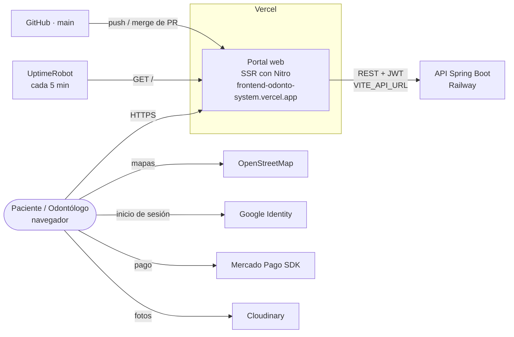

# Documentación de Despliegue — Portal web de OdontoSystem

Portal web para pacientes y odontólogos: **TanStack Start** (React 19 + Vite 8) con renderizado en servidor mediante **Nitro**.
Repositorio: `Nickssssss-del/Frontend_OdontoSystem` · Producción: <https://frontend-odonto-system.vercel.app> · Responsable: Nicole De La Cruz.
La API y su despliegue están documentados en el repositorio del backend ([DESPLIEGUE.md](https://github.com/Luaaa7/OdontoSystem/blob/main/docs/DESPLIEGUE.md)).

## 1. Arquitectura del sistema y entornos

### Diagrama de arquitectura de despliegue



El navegador descarga la página ya renderizada desde Vercel y, a partir de ahí, llama directamente a la API en Railway
con el token JWT del usuario. El portal no guarda claves de servicios externos: solo conoce la URL pública de la API y el
Client ID público de Google.

### Entornos disponibles

| Entorno | Dónde | Para qué |
|---|---|---|
| **Desarrollo (local)** | PC de la desarrolladora, `npm run dev` | Programar y probar. Por defecto llama a la API de producción (o a la que indique `VITE_API_URL` en `.env`). |
| **Vista previa (preview)** | Vercel, una URL por cada pull request | Revisar el cambio antes de fusionarlo. **Limitación:** la API solo acepta el dominio de producción (`CORS_ALLOWED_ORIGINS`), así que en la vista previa las pantallas que llaman a la API no cargan datos. |
| **Producción** | Vercel — <https://frontend-odonto-system.vercel.app> | Entorno vivo. Vercel publica automáticamente cada cambio que llega a `main`. |

## 2. Requisitos previos

| Elemento | Versión / servicio |
|---|---|
| Plataforma | Vercel, proyecto `frontend-odonto-system`, conectado a `Nickssssss-del/Frontend_OdontoSystem` desde el 15/10/2026 |
| Runtime | Node.js (la versión la fija Vercel en Settings → Build and Deployment → Node.js Version; en local se usa Node 22 LTS) |
| Gestor de paquetes | npm (`package-lock.json` en el repositorio) |
| Framework | TanStack Start 1.168 · React 19 · Vite 8 · Nitro 3 (renderizado en servidor) |
| Backend | API de OdontoSystem en Railway, con el dominio del portal en `CORS_ALLOWED_ORIGINS` |

## 3. Variables de entorno

Las variables con prefijo `VITE_` se **incrustan en el código al compilar**: son públicas por diseño y nunca deben contener
secretos. En producción se cargan en **Vercel → Settings → Environment Variables** y, para que un cambio tenga efecto, hay
que **volver a desplegar**. En local van en un archivo `.env`, que está en `.gitignore`.

Estado en Vercel (revisado el 19/11/2026): `VITE_API_URL` y `VITE_GOOGLE_CLIENT_ID` existen desde el 20/10/2026 y solo en
el entorno **Production**. En las vistas previas no están definidas: la API cae en su valor por defecto y el botón de Google
muestra el aviso de configuración.

| Variable | Obligatoria | Descripción | Valor de producción |
|---|---|---|---|
| `VITE_API_URL` | No | URL base de la API. Si falta, se usa la de producción (`src/lib/api.ts`). También define el origen permitido en la CSP (`src/server.ts`). | `https://odontosystem-production.up.railway.app` |
| `VITE_GOOGLE_CLIENT_ID` | Sí, para «Continuar con Google» | Client ID OAuth **de tipo Web**; el mismo que `GOOGLE_CLIENT_ID` del backend. Sin él, el botón de Google muestra un aviso y se entra con correo y contraseña (`src/components/GoogleBoton.tsx`). | `<id>.apps.googleusercontent.com` |

Plantilla para `.env` (está en el repositorio como [`.env.example`](../.env.example)):

```bash
VITE_API_URL=https://odontosystem-production.up.railway.app
VITE_GOOGLE_CLIENT_ID=
```

Configuración que vive en el backend y afecta al portal: `CORS_ALLOWED_ORIGINS` debe incluir
`https://frontend-odonto-system.vercel.app`; si el dominio cambia, hay que actualizarla en Railway.

## 4. Paso a paso del despliegue

### Opción A — Compilación y prueba en local

```bash
git clone https://github.com/Nickssssss-del/Frontend_OdontoSystem.git
cd Frontend_OdontoSystem
npm ci                     # instala exactamente las versiones del package-lock.json
cp .env.example .env       # y completar los valores (opcional para VITE_API_URL)
npm run dev                # desarrollo con recarga en caliente
npm run build              # versión de producción en .vercel/output/ (preset vercel de Nitro)
npm run preview            # sirve la versión de producción en local para revisarla
```

### Opción B — Despliegue en la nube (el que usa el proyecto): Vercel

**Configuración actual del proyecto en Vercel (revisada el 19/11/2026):**

| Ajuste | Valor |
|---|---|
| Framework Preset | **TanStack Start** (importado desde Lovable) |
| Build Command | Por defecto del preset (`npm run build` / `vite build`), sin *override* |
| Output Directory | Por defecto del preset, sin *override*. Nitro usa el preset `vercel` (fijado en `vite.config.ts`) y escribe `.vercel/output/` |
| Install Command | Detección automática (`npm install` por el `package-lock.json`), sin *override* |
| Repositorio | `Nickssssss-del/Frontend_OdontoSystem`, conectado el 15/10/2026, con comentarios en los PR activados |
| Rama de producción | `main` (cada merge genera un despliegue *Production*) |
| Dominio | `frontend-odonto-system.vercel.app` → Production, *Valid Configuration* |

**Para recrear el proyecto desde cero:**

1. Vercel → **Add New → Project** → importar `Nickssssss-del/Frontend_OdontoSystem`.
2. Dejar el Framework Preset **TanStack Start** y los comandos por defecto (no hace falta *override*). El preset de salida
   de Nitro (`vercel`) ya está en `vite.config.ts`; sin él, el wrapper de Lovable compila para Cloudflare.
3. **Environment Variables:** las de la sección 3, en el entorno *Production*.
4. Confirmar que la rama de producción es `main`.
5. Avisar al responsable del backend del dominio final para agregarlo a `CORS_ALLOWED_ORIGINS`.

**Cada despliegue:**

1. Trabajar en una rama (`nicole/…`, `fix/…`) y abrir un pull request hacia `main`.
2. Vercel crea una vista previa del PR (sección 1, con su limitación de CORS).
3. La CI de GitHub Actions corre lint, tipos, pruebas y build en el PR; fusionar solo con la CI en verde. En local se puede
   repetir con `npm run lint`, `npm run typecheck`, `npm run test` y `npm run build`.
4. Al fusionar el PR, Vercel compila `main` y, si la compilación termina bien, la publica en producción. Si falla,
   producción sigue con la versión anterior.
5. Hacer la prueba de humo de la sección 6.

## 5. Integración continua y despliegue continuo (CI/CD)

| Paso | Dónde | Estado |
|---|---|---|
| Despliegue continuo de `main` | Vercel, automático en cada merge | Activo |
| Vista previa por pull request | Vercel | Activo por defecto en Vercel (sin datos de la API por CORS) |
| Lint, tipos, pruebas y build en cada PR y en cada push a `main` | GitHub Actions (`.github/workflows/ci.yml`) | Activo: `npm ci` → `npm run lint` → `npm run typecheck` → `npm run test` → `npm run build`, con Node 22. No despliega: eso lo hace Vercel |
| Seguridad de dependencias | `npm audit` (manual) | Evidencias en el repositorio del backend (`docs/seguridad/evidencias/npm-audit-web-*.txt`) |
| Escaneo dinámico | OWASP ZAP (manual) | `docs/seguridad/evidencias/zap-web-antes.html` y `zap-web-despues.html` del backend |

**Cabeceras de seguridad en producción:** la CSP con *nonce* por petición, `X-Frame-Options`, `Referrer-Policy` y
`Permissions-Policy` las agrega el servidor (`src/server.ts`, MEJ-02). `X-Content-Type-Options`, `Permissions-Policy` y
`Cross-Origin-Opener-Policy` se declaran en `vite.config.ts` (`nitro.routeRules`), porque el preset `vercel` de Nitro no
copia las de `vercel.json`: la build las escribe en `.vercel/output/config.json`. `vercel.json` se conserva con los mismos
valores.

## 6. Monitoreo, verificación y rollback

- **Prueba de humo (smoke test)** después de cada despliegue:
  ```bash
  curl -I https://frontend-odonto-system.vercel.app/
  # HTTP 200 y la cabecera content-security-policy con 'nonce-…'
  ```
  En el navegador: iniciar sesión como paciente y como odontólogo, abrir «Dentistas en Ica» (carga el mapa y la lista desde
  la API) y la agenda del odontólogo. En DevTools → Console no debe haber errores de CSP ni de CORS.
- **Disponibilidad:** UptimeRobot revisa la página de inicio cada 5 minutos y avisa por correo si no responde 200
  (monitor `OdontoSystem Web`; ver `docs/MONITOREO.md` del backend).
- **Logs:** Vercel → proyecto → **Deployments** → despliegue → **Build Logs** (errores de compilación) y **Logs / Runtime
  Logs** (errores del renderizado en servidor). Los errores del navegador se ven en la consola de DevTools.
- **Plan de retorno (rollback):**
  1. Vercel → **Deployments** → elegir el último despliegue estable de producción → **⋯ → Promote to Production**
     (o **Instant Rollback**). El cambio es inmediato y no recompila.
  2. Repetir la prueba de humo.
  3. Corregir el fallo en una rama, abrir PR y fusionar normalmente: el siguiente despliegue de `main` vuelve a ser el de
     producción.
  4. El portal no tiene base de datos propia: el rollback no afecta datos. Si el problema venía de un cambio de la API,
     el rollback se hace en Railway (DESPLIEGUE.md del backend).
- **Redespliegue probado el 19/11/2026:** el commit `b7ca067` (merge del PR #25) se publicó en producción a las 21:03 y a las
  21:05 se hizo un *rebuild* de producción de ese mismo despliegue (`2CQv7Ga1K`), que quedó *Ready* en 27 s.
- **Rollback probado el 19/11/2026** con *Promote to Production* en Vercel:

  | Hora | Acción | Despliegue en producción |
  |---|---|---|
  | 23:04 | Retorno a la versión anterior | Merge del PR #24 (`5373262`, `fix/responsive-movil`) |
  | 23:06 | Regreso a la versión vigente | Merge del PR #25 (`b7ca067`, `fix/web-final-movil`) |

  Cada cambio fue inmediato, porque Vercel reutiliza el despliegue ya compilado y no vuelve a construir. Producción quedó de
  nuevo en `b7ca067`.

## 7. Pendientes conocidos

- Opcional: definir también `VITE_GOOGLE_CLIENT_ID` en el entorno *Preview* para probar el inicio con Google en las vistas previas.
