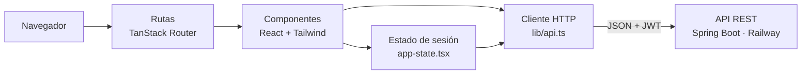
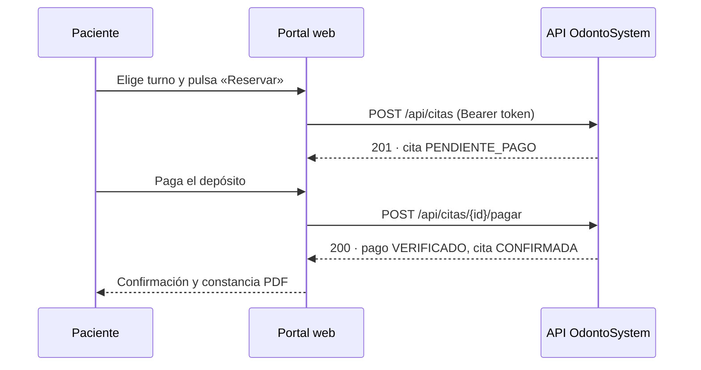

<div align="center">

# OdontoSystem · Portal web

**Interfaz web del marketplace dental OdontoSystem para pacientes y odontólogos de Ica**

[](https://frontend-odonto-system.vercel.app)


[Ver la aplicación](https://frontend-odonto-system.vercel.app) · [Backend (API)](https://github.com/Luaaa7/OdontoSystem) · [App móvil](https://github.com/Nickssssss-del/APPFRONTENDODONTO)

</div>

---

## Descripción

El portal web es la **capa de presentación** (la *Vista* del patrón MVC) de OdontoSystem. No contiene reglas de negocio ni se conecta a la base de datos: todo lo obtiene de la API REST del backend Spring Boot, que valida, calcula y guarda la información.

| Paciente | Odontólogo |
|---|---|
| Busca odontólogos verificados por distrito, especialidad y cercanía en un mapa | Gestiona su agenda del día y confirma o completa citas |
| Revisa el perfil, los servicios, las reseñas y el sello COP | Define horarios de atención y bloqueos de emergencia |
| Elige un turno libre y paga el depósito de garantía | Sube sus documentos y sigue su verificación COP |
| Consulta sus citas, descarga constancias y pide reembolsos | Registra historias clínicas, responde reclamos y ve sus liquidaciones |
| Conversa con el chatbot para buscar o agendar | Administra servicios, precios y fotos del consultorio |

## Arquitectura



**Cliente HTTP único (`src/lib/api.ts`)**

- Lee la URL del backend de la variable `VITE_API_URL`.
- Envía el token en la cabecera `Authorization: Bearer …`.
- Si el token de acceso vence (15 min), pide uno nuevo a `/api/auth/refresh` y repite la llamada una vez.
- Usa el mismo contrato que publica Swagger: JSON en `snake_case` y valores en español (`PENDIENTE_PAGO`, `CONFIRMADA`…).



## Pantallas y requerimientos

| Requerimiento | Ruta / componente | Endpoint principal |
|---|---|---|
| RF01 Registro e inicio de sesión | `index.tsx`, `recuperar.tsx` | `/api/auth/register`, `/login`, `/refresh` |
| RF16 Inicio con Google | `GoogleBoton.tsx` | `/api/auth/google` |
| RF02 Búsqueda con mapa | `paciente.catalogo.tsx`, `DentistMap.tsx` | `GET /api/odontologos` |
| RF12 Perfil público y reseñas | `paciente.dentista.$id.tsx` | `GET /api/odontologos/{id}` |
| RF03 Reserva de turno | `paciente.agendar.$id.tsx`, `SelectorTurnos.tsx` | `POST /api/citas` |
| RF13 Pago del depósito | `PasarelaPago.tsx` | `POST /api/citas/{id}/pagar` |
| RF04 · RF05 · RF14 · RF15 Mis citas | `paciente.panel.tsx`, `AccionesCita.tsx` | `/api/citas/mias`, `/cancelar`, `/constancia`, `/reembolsos` |
| RF06 · RF07 Horarios y bloqueos | `dentist.horarios.tsx` | `/api/odontologos/yo/horarios`, `/bloqueos` |
| RF08 · RF09 Verificación COP | `VerificacionCOP.tsx`, `dentist.perfil.tsx` | `/api/odontologos/yo/verificacion` |
| RF11 Confirmación de citas | `dentist.agenda.tsx` | `/api/odontologos/yo/citas/{id}/confirmar` |
| Historias clínicas | `dentist.pacientes.tsx` | `/api/citas/{id}/historia` |
| Liquidaciones | `dentist.liquidaciones.tsx` | `/api/odontologos/yo/liquidaciones` |
| Libro de reclamaciones | `reclamos.tsx`, `dentist.reclamos.tsx` | `/api/reclamos` |
| Chatbot | `ChatbotWidget.tsx` | `POST /api/chatbot/mensaje` |

## Tecnologías

| Uso | Librería |
|---|---|
| Interfaz | React 19, TypeScript, Tailwind CSS 4, componentes Radix UI |
| Navegación | TanStack Router (rutas por archivo en `src/routes`) |
| Formularios y validación | React Hook Form + Zod |
| Mapas | Leaflet + React Leaflet |
| Gráficos de indicadores | Recharts |
| Notificaciones en pantalla | Sonner |

## Estructura

```
src/
├── routes/        una ruta por pantalla (paciente.*, dentist.*, odontologo.*)
├── components/    componentes reutilizables (mapa, pasarela, chatbot, perfil…)
│   └── ui/        componentes base (botones, diálogos, formularios)
├── lib/           cliente de la API, estado de sesión y utilidades de formato
└── hooks/         hooks propios
```

## Cómo ejecutarlo

```bash
npm install
# opcional: crear .env con VITE_API_URL=<url del backend>
#           (si no existe, se usa el backend publicado en Railway)
npm run dev              # http://localhost:5173
npm run build            # versión de producción
```

## Seguridad

- El frontend nunca guarda claves de servicios externos; solo la URL pública de la API.
- La tarjeta la tokeniza el formulario de pago: sus datos no pasan por nuestro servidor.
- Las pantallas se muestran según el rol de la sesión (paciente u odontólogo), y el backend vuelve a validar el rol en cada petición.

## Equipo y flujo de trabajo

| Integrante | Aporte |
|---|---|
| **Nicole De La Cruz Chávez** | Diseño UX/UI, pantallas de paciente y odontólogo, integración con la API |
| Luana Barrientos Espinoza | Apoyo en la integración con la API (catálogo real y panel del paciente) |

El prototipo inicial de las pantallas se generó con Lovable y luego se adaptó al contrato real de la API.
Cada cambio se desarrolla en una rama con el nombre de su autora (`nicole/…`, `luana/…`) y se integra a `main` mediante pull request; Vercel publica `main` automáticamente.
